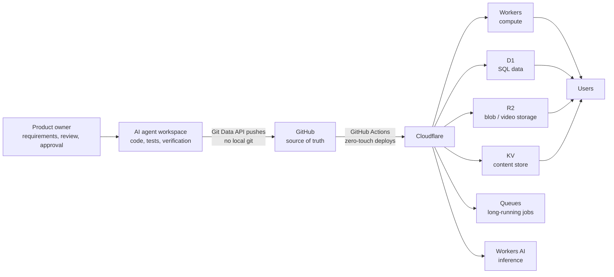

# Architecture — Agent-to-Production on Cloudflare

Every product in this portfolio is built and operated the same way: a product owner directing an AI engineering agent that writes the code, runs the tests, and deploys to production. This document describes that pipeline and the per-project stacks.

## The delivery pipeline

- **Source control:** repositories are pushed through the GitHub Git Data API (blobs → tree → commit → ref), which keeps deploys scriptable from the agent's environment.
- **CI/CD:** GitHub Actions workflows deploy Workers and static sites on merge — no manual upload steps, and the same pipeline provisions D1 databases and applies schemas.
- **Secrets:** credentials live only in platform secret stores and CI secrets. Nothing sensitive is committed — the configuration files in this showcase carry placeholders where production carries real identifiers.
- **Verification:** a change is not "done" when the code looks right. It is done when the deployed system has been exercised end-to-end (real browser flows, live API calls, rendered-output checks).

## Per-project stacks

### Dinklytics — pickleball assessment service
- **Storefront:** a single Cloudflare Worker serves dinklytics.com (site + order form).
- **Intake:** Google Apps Script accepts orders and acts as the tripwire that wakes the processing pipeline; a reconcile loop guarantees no submission is ever lost.
- **Uploads:** customers upload match video from mobile browsers directly to **R2** through an upload Worker using chunked multipart uploads with per-part resume — built for large files on flaky phone connections.
- **Processing:** a strictly serial job queue (one assessment at a time, oldest first) with a watchdog that resumes stalled jobs from their last completed stage.
- **Reports:** a Python/ReportLab engine renders a magazine-style PDF — ratings dashboard, stroke-by-stroke analysis, annotated teaching frames — from a structured analysis of the footage.
- **Delivery:** finished reports are archived to Google Drive and emailed to the customer automatically.

### Acuity — tax & wealth planning
- **Front end:** React + TypeScript SPA.
- **API:** Cloudflare Worker backed by **D1** (job queue and plan storage).
- **Intelligence split:** a deterministic rules engine computes every number from current-year IRS figures; **Workers AI** (Llama 3.3 70B) writes the plan narrative and chat answers, grounded in the engine's output and barred from inventing figures.
- **Long jobs:** plan generation runs on **Queues**, so multi-minute section-by-section generation never blocks a request.
- **Hardening:** fail-closed authentication, per-IP rate limits, parameterized queries, schema-validated updates, pinned-action CI.

### Poker Night — shared live game tracker
- **Front end:** a dependency-free single-page app (also packaged as a native iOS build with Capacitor).
- **Sharing model:** every game table is a cloud session on **Workers + D1**. Share links carry role tokens (host / edit / view) in the URL fragment, so tokens never reach server logs; clients poll for live sync and resolve write conflicts with revision checks.
- **Money math:** buy-ins, mid-game cash-outs, shared expenses, and a minimized settle-up (fewest payments) with per-player Venmo/Cash App/PayPal deep links — all computed deterministically in the app.

### Harvest Church CMS
- **One Worker does everything:** public site, admin console, and JSON API, with content in **KV** (~160 editable fields, repeaters, per-page and per-section visibility).
- **Auth:** PBKDF2-HMAC-SHA-512 password storage, login lockouts, per-session CSRF tokens, hash-based CSP and a full security-header set, plus an admin security dashboard and audit log.
- **Editorial safety:** every save snapshots the prior content — any change is restorable from a 30-revision history, so non-technical staff can edit without fear.

### Don't Waste Your Money — investment research
- **Static-first:** a static site whose data layer is ~100 individual topic files (one per holding) validated against JSON schemas before publish; research runs twice daily and deep-dive rotations twice weekly update the data without touching the site code.
- **Guardrails by design:** no live prices, no personalized advice, no return promises — educational research only, in plain language a beginner can follow.

## Operating principles

1. **Free-tier first.** The entire portfolio runs on free or near-free tiers (Cloudflare free plans, GitHub, Google free quotas) — cost discipline is an architecture input, not an afterthought.
2. **Deterministic where it counts.** Money, tax, and ratings math is computed by code that can be unit-tested; AI is used for language, vision, and judgment support — never as the calculator.
3. **Recoverable by default.** Job queues with heartbeats, content version history, and idempotent deploys mean failures resume instead of restarting.
4. **Verified live.** Tests run against the deployed system, in a real browser, before a result is reported.
